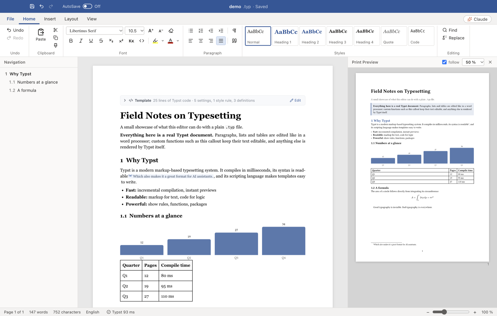

# Typewright

**A word processor for [Typst](https://typst.app).** Open any `.typ` file and edit it like a Word document: pages with real margins and fonts, a ribbon, styles, tables, pictures, footnotes, find & replace, spell checking. Next to it, the real Typst output as a live print preview. And if you like, Claude Code or Codex right inside the window.



## Why

Typst is a joy to write, and it turns out AI assistants write excellent Typst too. But not every change needs code or an AI: sometimes you just want to fix a sentence, swap a term or highlight something. Typewright gives you a familiar word-processor view of the very same `.typ` file, while the AI (or you, in the source view) works on the text underneath.

The file stays the source of truth. Parts the editor doesn't understand as plain text (your own functions, templates, diagrams) stay Typst code and are rendered exactly as they appear in the PDF. When you save, everything you didn't touch is written back character for character, so a diff only ever shows what you actually changed.

## Built on Typst ❤️

Typewright exists because Typst is wonderful, and all the hard typesetting work is Typst's:

- Documents are parsed with Typst's own parser, the [`typst-syntax`](https://crates.io/crates/typst-syntax) crate, so the editor sees exactly what Typst sees.
- Every page in the preview, every rendered snippet in the editor and every exported PDF comes from the Typst compiler itself.

Huge thanks to Laurenz Mädje, Martin Haug and everyone who builds Typst. If you enjoy Typewright, please support Typst: use [the Typst web app](https://typst.app), contribute to [typst/typst](https://github.com/typst/typst) and share packages on [Typst Universe](https://typst.app/universe).

*Typst is a trademark of Typst GmbH. Typewright is an independent, non-commercial open-source project and is not affiliated with or endorsed by Typst GmbH.*

## Features

- **Word-like editing:** paragraphs, headings, lists, tables (merge, header rows), pictures and figures, links, footnotes, cross-references, equations, code blocks, page breaks, table of contents.
- **Formatting that maps to Typst:** bold, italic, underline, strikethrough, sub/superscript, small caps, font, size, color and highlight become `*…*`, `#text(…)[…]`, `#highlight[…]` and friends.
- **Document layout** (Layout tab): paper size, orientation, margins, columns, header and footer, page numbers, default font and size, language, justification, line and paragraph spacing, heading numbering. These are written as `#set` rules in your document's template.
- **Your own functions stay yours:** text inside `#callout[…]`, `#txt[…]` and the like stays editable; code-only calls such as charts are rendered by Typst right in the page.
- **Live print preview** that follows your scroll position, plus page count, word count and compile errors.
- **Multi-file projects:** a chapter included via `#include` is previewed through its main file, with the main file's template.
- **Typst source view** side by side; edits there apply immediately.
- **AutoSave**, conflict protection and live reload when the file changes on disk.
- **English and German** user interface (File → Options).

## AI in the terminal

Typewright has a built-in terminal panel (⌘J) that starts **Claude Code**, **Codex** or any command you choose, in your project folder and with your own subscription.

- The AI knows that "the document" is the file open in the editor. Claude Code receives the open file, its outline, the section and paragraph at your cursor and your selection with every message; Codex reads the same context from a file the editor keeps up to date.
- Say *"update the title"* or *"make this paragraph shorter"* and watch the change appear live in the page, briefly highlighted. ⌘Z (or the *Undo* button in the notification) takes it back.
- ⌘L sends your selection to the AI's input, like in Cursor.
- The panel docks to the bottom, top, left or right.
- While the panel is open, AutoSave is on, so the AI always reads your latest text. If the AI changes the file while you have unsaved edits, Typewright asks instead of overwriting.

## Install

Typewright currently targets **macOS** (Apple Silicon). There are no prebuilt downloads yet, so build it from source:

```sh
brew install typst          # the Typst CLI (Typewright uses it for preview and export)
# Node.js 22 and a Rust toolchain are also required

git clone https://github.com/MHU92/typewright.git
cd typewright
npm install
npm run dist                # → release/mac-arm64/Typewright.app
```

Copy `Typewright.app` to `~/Applications` or `/Applications` and open `.typ` files with it (Finder → Open With).

For development: `npm run build:native` once, then `npm run dev` (Vite + Electron with live reload).

## How it works

| Part | Implementation |
| --- | --- |
| Parsing | `native/typst-parse`: a tiny Rust program around `typst-syntax` that returns the lossless syntax tree as JSON |
| Typst → editor | `src/typst/parse.ts` turns the tree into a ProseMirror document (TipTap) |
| Editor → Typst | `src/typst/serialize.ts`; unchanged blocks come back verbatim from the original source |
| Rendering in the editor | Code blocks and equations are rendered as pages of a helper document that carries your template (`src/render/snippets.ts`) |
| Page look | Paper, margins, font, size, spacing and numbering are read from Typst (`typst eval`) |
| Preview | `typst compile` to SVG; unsaved text is compiled through a mirror folder of symlinks, so relative imports and images keep working |
| AI terminal | xterm.js + node-pty; Claude Code gets instructions via `--append-system-prompt` and the live context via a `UserPromptSubmit` hook |

## Tests

```sh
npm test                                   # round-trip tests + translation check
npx tsx tests/roundtrip.ts my/file.typ     # run the round trip on your own files
```

For every file, the round-trip test checks that (1) loading and saving without changes reproduces the source exactly, and (2) writing the whole document from scratch makes Typst render identical pages (compared as SVG). During development it passed on 27 real-world documents (contracts, business plans, pitch decks, reports).

UI tests can be scripted: `TW_AUTOTEST=script.js TW_SCREENSHOT=shot.png npx electron . file.typ` runs a script in the window (`window.__tw` exposes the editor and commands), saves a screenshot and quits.

## Limitations and ideas

- No track changes or threaded comments yet (Typst `//` comments are shown as notes and can be inserted).
- The editor is one continuous page; real page breaks are shown in the preview.
- Clicking in the preview doesn't jump to the editor yet.
- No `.docx` import/export (pandoc could make that possible).
- Custom `#show` rules for headings are only approximated in the editor; the preview is exact.
- Some code comments are still in German. Translations welcome.

Contributions are very welcome. UI strings go through `t('English text')` with German translations in `src/de.ts` (`npm run check:i18n` lists missing ones).

## License

[Apache License 2.0](LICENSE), the same license as Typst. See [NOTICE](NOTICE) for third-party credits.
